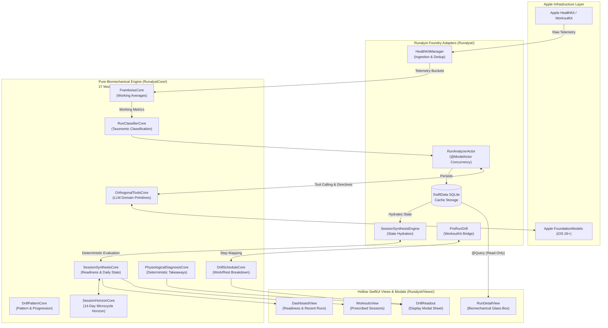

# Runalyst

Runalyst is a minimal, native iOS application acting as an "analytical mirror" for runners. It leverages **Apple HealthKit** to read your past running data, utilizes an on-device **CoreML classification model**, mathematically evaluates your performance via the pure **RunalystCore** engine, and uses **Apple's on-device Foundation Models** to generate plain-text coaching insights and technique drills. All of this happens completely privately, locally on-device, and without tracking live GPS or workouts.

## Features

- **Passive Sync**: Reads your previous running data seamlessly from Apple HealthKit and WorkoutKit.
- **Biomechanical Evaluation**: The pure `RunalystCore` engine normalizes HealthKit data, excluding dead-stops, to calculate true working averages for metrics like cadence, heart rate, stride length, ground contact time, and vertical oscillation.
- **On-Device Machine Learning**: Uses a trained CoreML model (`RunalystClassifier`) to automatically classify run types (e.g., Threshold, Easy, Long Run, Cadence Pyramids) based on pace, heart rate zones, and biomechanics.
- **Private Generative AI**: Uses native iOS 26 on-device FoundationModels (`LanguageModelSession`) to parse deterministic performance directives into conversational, actionable coaching insights.
- **Actionable Drills & Structured Workouts**: Provides targeted technique drills (e.g., Cadence Pyramids, Rhythm Intervals, Strides) with structured step phases exportable to Apple Watch via WorkoutKit.
- **Minimalist "Sweaty Hands" UX**: High-contrast, tactile SwiftUI interface designed with 44x44pt touch targets, `.monospacedDigit()` jitter-free telemetry, and SF Pro Rounded typography.

## Architecture: Forward & Reverse Air-Gap

Runalyst enforces a strict **Assay-Driven Engineering Model** separating pure deterministic sports science from heavy iOS platform infrastructure:

1. **Forward Air-Gap (`RunalystCore`)**: 27 pure, sans-I/O Swift modules (`<= 500 LOC` each). Imports only `Foundation`. Zero `HealthKit`, zero `SwiftData`, zero `SwiftUI`, and zero wall-clock `Date()` or dynamic `Calendar.current` calls.
2. **Reverse Air-Gap (Hollow Views & Adapters)**: SwiftUI views (`Runalyst/Views/`) and modal/workout builders (`DrillReadout.swift`, `PreRunDrill.swift`) are pure read-only renderers and mappers over immutable `RunalystCore` structs. Zero leaked domain math, zero inline threshold checks, and zero phase arithmetic in the UI layer.



## Tech Stack

- **Language**: Swift 6 (Strict Concurrency, `@ModelActor`, `Sendable`)
- **Core Domain**: `RunalystCore` (Pure Swift Package, 27 modules, Zero I/O)
- **UI Framework**: SwiftUI (Hollow View Pattern, Sweaty Hands UX)
- **Persistence**: SwiftData (SQLite local store)
- **Health Data**: Apple HealthKit & WorkoutKit
- **Machine Learning**: CoreML (`RunalystClassifier.mlmodel`, Random Forest tabular classifier)
- **AI Engine**: Apple FoundationModels (`LanguageModelSession`, native tool calling, `@Generable`)

## Requirements

- **iOS 26.0+** (Required for the `LanguageModelSession` FoundationModels SDK and WorkoutKit updates)
- **Xcode 18.0+**
- An iOS physical device with **Apple HealthKit** configured and containing running workout data. Testing on-device FoundationModels and the Neural Engine for CoreML requires a physical device.

## How to Run

1. Clone this repository to your local machine.
2. Open the project in **Xcode** (`open Runalyst.xcodeproj`).
3. In the project settings, ensure your **Team** is selected under Signing & Capabilities.
4. Ensure the **HealthKit** capability is added to your target.
5. Select a compatible iOS Physical Device (iOS 26+).
6. Build and Run (`Cmd + R`).

## Documentation & Architecture

For deep dives into Runalyst specifications, architecture, and governance:
- **[System Constitution](CONSTITUTION.md)**: Non-negotiable laws, air-gap gates, 500 LOC ceiling, and `./assay.sh` verification.
- **[System Architecture](docs/ARCHITECTURE.md)**: Detailed component interactions, concurrency actors, and hollow view doctrine.
- **[AI & CoreML Pipeline](docs/AI_PIPELINE.md)**: Tabular feature vectors, training workflows, token budgeting, and orthogonal tool design.
- **[Core Development Guide](docs/CORE_DEVELOPMENT_GUIDE.md)**: Four-step pipeline for adding or extending `RunalystCore` modules.
- **[Product Blueprint](docs/BLUEPRINT.md)**: Walter's Hierarchy of Needs, Sweaty Hands UX, and the "Thick Client, Thin AI" manifesto.
- **[Contributing](CONTRIBUTING.md)**: OpenSpec development, subagent delegation hierarchy, and PR requirements.

## Repository Structure

```
runalyst/
├── RunalystCore/                 # Pure Swift Package (27 Sans-I/O Domain Modules <= 500 LOC)
│   ├── Package.swift
│   ├── Sources/RunalystCore/     # FramboiseCore, RunClassifierCore, DrillScheduleCore, etc.
│   └── Tests/RunalystCoreTests/  # Sub-5ms Crucible unit tests & golden fixtures
├── Runalyst/                     # iOS Foundry Application (Framework Layer)
│   ├── Engine/                   # Foundry adapters (PreRunDrill, SessionSynthesisEngine)
│   ├── Models/                   # SwiftData schemas, migrations & modal readouts (DrillReadout)
│   ├── CoachingEngine/           # FoundationModels integration & tool routing
│   ├── Managers/                 # HealthKitManager, WatchConnectivityManager
│   ├── Utilities/                # Formatting & UI color tokens
│   └── Views/                    # Hollow SwiftUI Views (DashboardView, WorkoutsView, RunDetailView)
├── RunalystTests/                # Integration, mill persistence, and telemetry veracity tests
├── openspec/                     # Spec-Driven Development changes, specs, and proposals
├── .agent/skills/                # Engineering Org delegation & OpenSpec agent skills
├── docs/                         # Architecture, AI pipeline, blueprint, and ADR specifications
└── scripts/                      # Machine learning training and App Store asset utilities
    ├── generate_seed_runs.py     # Synthetic data generation for CoreML tabular training
    ├── train_model.py            # Random Forest training and CoreML model compilation
    ├── capture_raw_screenshots.py
    ├── encode_app_previews.py
    ├── generate_app_store_screenshots.py
    ├── generate_ipad_promo_video.py
    ├── generate_ipad_screenshots.py
    ├── generate_promo_video.py
    └── record_app_previews.py
```

## Development & CI/CD

Runalyst uses GitHub Actions for continuous integration.
- **The Assay (`./assay.sh`)**: Local and CI verification gate auditing Directory Air-Gap purity, zero wall-clock time in Core, `<= 500 LOC` mass cap, strict SwiftLint compliance, Grounded Voice lexicon, and Crucible test execution.
- **Seed Data & CoreML Training**: Synthetic balanced running datasets are generated via `scripts/generate_seed_runs.py` and trained into `RunalystClassifier.mlmodel` using `scripts/train_model.py`.

### Retraining the CoreML Classifier
To generate updated training datasets and retrain the classifier:
1. Run data synthesis: `python3 scripts/generate_seed_runs.py`
2. Run model training and export: `python3 scripts/train_model.py`
3. The resulting `RunalystClassifier.mlmodel` is validated against test suites covering all 11 taxonomic running classes.

## Note on Privacy & Scope

Runalyst explicitly **does not** integrate third-party cloud APIs (OpenAI, Anthropic, etc.), **does not** build a custom backend or require user authentication, and **does not** track live workouts or request GPS permissions. All analysis is done securely, deterministically, and privately on-device.
