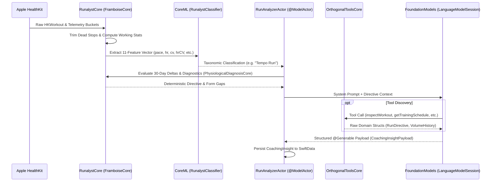

# AI & CoreML Pipeline

Runalyst employs a **"Thick Client, Thin AI"** hybrid intelligence pipeline: deterministic Swift sports science does the math, on-device CoreML classifies workout taxonomy, and native Apple FoundationModels (`LanguageModelSession`) synthesize empathetic coaching language and execute orthogonal tool calls.

This strict division ensures the on-device LLM never hallucinates biomechanical numbers, pace splits, or physiological recovery timelines.

---

## Pipeline Architecture



---

## 1. The CoreML Classifier

The `RunalystClassifier.mlmodel` is an offline-trained Random Forest tabular classifier embedded in the app target. It classifies each workout into one of 11 canonical taxonomic classes:
1. `Recovery Run`
2. `Easy Run`
3. `Steady Effort`
4. `Progression Run`
5. `Tempo Run`
6. `Fartlek`
7. `Intervals`
8. `Hill Repeats`
9. `Cadence Pyramids`
10. `Long Run`
11. `Urban Traffic`

### Feature Vector Specification
The model consumes an 11-dimensional feature vector extracted deterministically by `FramboiseCore`:
- `paceDelta`: Difference between working pace and 30-day baseline (s/km).
- `hrDelta`: Difference between working HR and 30-day baseline (BPM).
- `percentZone4`: Proportion of time spent in anaerobic Zone 4 / Zone 5.
- `cadenceDelta`: Turnover change relative to 30-day rolling baseline (SPM).
- `verticalOscillation`: Mean bounce height in centimeters.
- `cv`: Pace coefficient of variation (statistical volatility).
- `paceSlope`: Monotonic acceleration gradient across split quintiles.
- `runnerStage`: Runner profile experience tier (0 = Beginner to 3 = Elite).
- `durationMinutes`: Active workout duration.
- `cadenceCV`: Turnover regularity coefficient of variation.
- `hrCV`: Heart rate volatility coefficient of variation.

### Retraining & Data Synthesis
The model is trained entirely on synthetic, balanced data to prevent class imbalance:
1. `python3 scripts/generate_seed_runs.py` synthesizes 40,000 runs across all 11 classes, generating `CoreML_Training_Data_v6.csv` and `CoreML_Testing_Data_v6.csv`.
2. `python3 scripts/train_model.py` trains the `RandomForestClassifier` with `scikit-learn`, executes the 11-case validation test suite, converts the model via `coremltools`, and outputs `RunalystClassifier.mlmodel`.
3. Automated CI via `.github/workflows/generate-seed-data.yml` verifies data synthesis and training on main branch pushes.

---

## 2. Deterministic Directives & Sports Science Core

Language models fail when tasked with calculating metric deltas, standard deviations, or cardiac drift. In Runalyst, all mathematical decisions occur strictly in `RunalystCore`:
- **`FramboiseCore`**: Computes working averages excluding dead stops.
- **`IntervalSegmenterCore`**: Segments interval surges and walk-recovery troughs using rolling baselines.
- **`PhysiologicalDiagnosisCore`**: Identifies overstriding, cardiac drift, and biomechanical fatigue.
- **`SessionHorizonCore`**: Synthesizes 14-day microcycle progression without calendar drift.

### The Directive Context Pattern
`RunAnalyzerActor` translates core math into an unambiguous textual directive injected into the LLM system prompt:

```
// Example Directive Context:
Current: 148 SPM (BELOW the 150 SPM floor). Baseline: 158 SPM. Deltas: Pace +12s/km, HR +6 BPM.
GROUP_B_FORM: High vertical bounce detected (10.6 cm).
DIRECTIVE: Prescribe Cadence Pyramids. Safety overrides any race goal.
```

**Guardrail Priority**: When biological fatigue is detected (`paceDiff < 0 && hrDelta > 0`), Swift deterministically overrides user training goals with `"PRIORITY: prescribe Easy Aerobic Recovery"`.

---

## 3. Native Tool Calling (`OrthogonalToolsCore`)

On-device FoundationModels interact with app state through Apple's native Tool Calling protocol (`Tool` protocol conformance). Tool endpoints are strictly orthogonal:
- **`inspectWorkout`**: Diff two workouts polymorphically using `HistoricalQueryCore`.
- **`getTrainingSchedule`**: Query timeline over a continuous date range (`from: Date, to: Date`).
- **`getReadinessAndWorkload`**: Retrieve Banister TRIMP and acute:chronic workload ratios.
- **`queryWorkoutHistory`**: Filter historical logs by tags and terrain without conversational scripting.

### Zero Scripted Dialogue Law
Tools return raw domain primitives, enums, and numerical telemetry. Swift never constructs canned conversational phrases inside tools; the LLM discovers state and generates its own empathetic coaching prose.

---

## 4. FoundationModels Generation (`LanguageModelSession`)

The generative coaching layer runs natively on iOS 26+ via Apple's `LanguageModelSession`.

### Structured Output with `@Generable`
We define compiler-checked schemas with granular property guides:

```swift
@Generable
public struct CoachingInsightPayload {
    @Guide(description: "One-sentence high-impact coaching diagnosis based on the directive.")
    public var diagnosisHeadline: String

    @Guide(description: "Empathetic analysis of today's effort. Maximum 2 sentences. No cheerleading clichés.")
    public var coachingBody: String

    @Guide(description: "Exact drill title from allowed list: Cadence Pyramids, Rhythm Intervals, Tempo Surges, Strides.")
    public var drillTitle: String

    public var drillWork: String
    public var drillRecovery: String
    public var drillCues: String
    public var drillEffort: String
    public var drillPurpose: String
}
```

### Apple TN3193 Token Budgeting
On-device models enforce a hard **4,096-token ceiling**:
- Capped array sizes in `@Guide(description:)` (never use `maximumCount`).
- Compact, comma-delimited input strings instead of verbose JSON payloads.
- System prompt constrained to under 3 paragraphs and 10 clear rules.
- Localized response instruction: `"Respond entirely in \(Locale.current.language.languageCode)"`.
