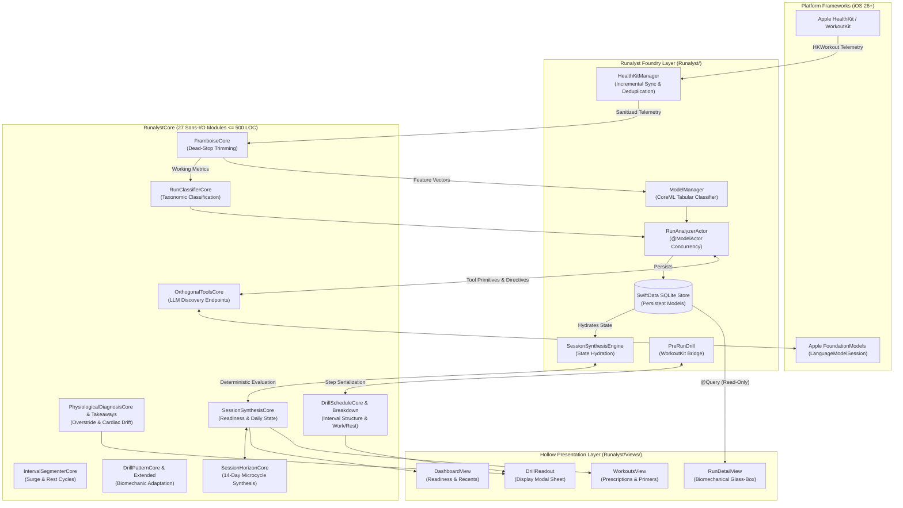
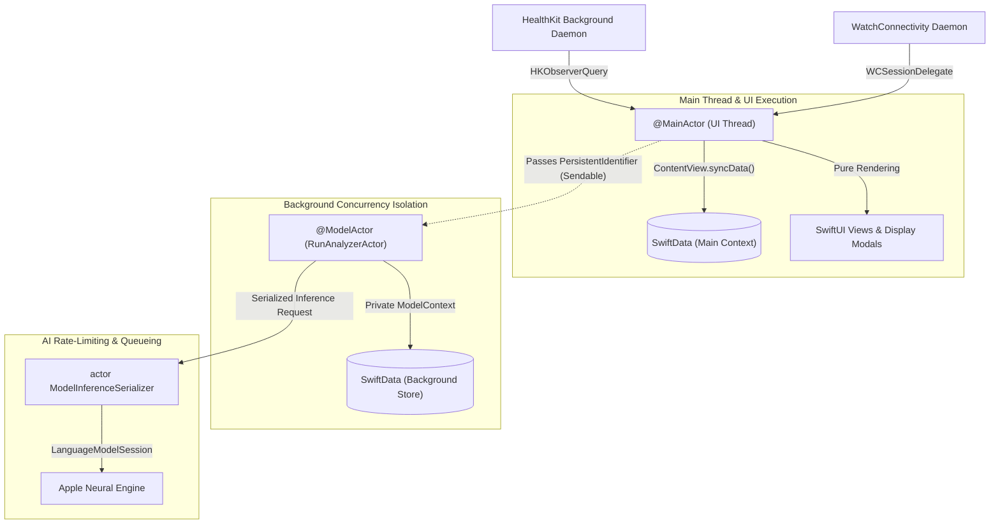

# System Architecture

Runalyst is architected around a strict **Assay-Driven Engineering Model** separating pure deterministic sports science from heavy iOS platform infrastructure through a bidirectional air-gap:

- **Forward Air-Gap (`RunalystCore`)**: A pure, sans-I/O Swift Package containing 27 cohesive domain modules (`<= 500 LOC` each) importing only `Foundation`. It deterministically models biomechanical kinematics, cardiovascular load, interval segmentation, and training horizons.
- **Reverse Air-Gap (Foundry & Hollow Views)**: iOS service adapters (`Runalyst/Engine/`, `Runalyst/Managers/`) hydrate persistence models and map to `WorkoutKit`. SwiftUI presentation views (`Runalyst/Views/`) and display modals (`DrillReadout.swift`) are pure read-only renderers over immutable `RunalystCore` structs.

For the overarching product manifesto and User-Centered Design philosophy, see [The Runalyst Product & Architecture Blueprint](BLUEPRINT.md).

---

## High-Level Data Flow & Air-Gap Boundary

---

## Architectural Layers

### 1. The Pure Sports Science Core (`RunalystCore/`)
The reference core contains 27 independent, pure Swift modules. Every file enforces a strict **500 LOC ceiling**, uses companion `<Module>+Extension.swift` files when domain complexity grows, and forbids any imports of `HealthKit`, `SwiftData`, `CoreML`, `SwiftUI`, or `OSLog`.

| Category | Modules | Responsibilities |
| :--- | :--- | :--- |
| **Data Contracts** | `TheMold.swift` | Value types, `TelemetryBucket`, `Sendable` contracts, and domain directives. |
| **Normalization & Math** | `FramboiseCore.swift`, `WorkoutMathCore.swift` | Sensor dead-stop trimming, true working averages, statistical variance. |
| **Taxonomy & Segments** | `RunClassifierCore.swift`, `IntervalSegmenterCore.swift`, `TreadmillKinematicsCore.swift` | 11 taxonomic classes, interval rep/recovery segmentation, treadmill friction physics. |
| **Biomechanics & Diagnostics** | `PhysiologicalDiagnosisCore.swift`, `PhysiologicalDiagnosisCore+Takeaways.swift` | Overstriding, vertical ratio, cadence decay, and deterministic coaching takeaways. |
| **Drill Prescription** | `DrillPatternCore.swift`, `DrillPatternCore+Extended.swift`, `DrillScheduleCore.swift`, `DrillScheduleCore+Breakdown.swift`, `DrillAdherenceCore.swift`, `DrillEvaluationCore.swift`, `DrillEvaluationTypesCore.swift` | Drill archetypes, dynamic duration scaling, work/rest step phase breakdowns, compliance scoring. |
| **State & Horizon Synthesis**| `SessionSynthesisCore.swift`, `SessionHorizonCore.swift`, `BanisterReadinessCore.swift`, `MacroVolumeCore.swift`, `TemporalSnapshotCore.swift`, `ProgressionChartCore.swift`, `GoalBenchmarkCore.swift`, `HistoricalQueryCore.swift`, `LifetimeMilestonesCore.swift`, `RunGradeCore.swift`, `TrainingZoneCore.swift` | Daily training state (preRun, completedPrimer, completedToday), 14-day microcycle progression, TRIMP/ACWR, Mon-Sun calendar windowing. |
| **LLM Domain Interface** | `OrthogonalToolsCore.swift` | Native FoundationModels Tool calling schemas returning raw domain structs. |

### 2. The Foundry Adapters (`Runalyst/Engine/`, `Runalyst/Managers/`)
iOS-specific classes that bridge device telemetry to `RunalystCore` and back:
- **`HealthKitManager.swift`**: Passive workout ingestion, batching commits every 25 runs, and O(1) set-based deduplication (`Set<UUID>`).
- **`RunAnalyzerActor.swift`**: Background `@ModelActor` calculating 30-day relative baselines, invoking CoreML, and executing FoundationModels synthesis without blocking the UI.
- **`SessionSynthesisEngine.swift`**: Maps SwiftData records into pure `DailyTrainingState` and `SessionHorizonCore` entities.
- **`PreRunDrill.swift`**: Maps `DrillScheduleCore` steps directly to Apple `WorkoutKit` custom workouts with indoor/outdoor cadence alert adjustments.
- **`ModelManager.swift`**: Wraps the tabular `RunalystClassifier.mlmodel` for inference across 11 taxonomic running classes.

### 3. Hollow Views & Display Modals (`Runalyst/Views/`)
In strict adherence to the **Hollow View Doctrine**, views do not contain domain calculations:
- **Zero Inlined Math**: Views never calculate zone thresholds (`percentZone4 > 0.15`), interval phases, or duration mappings.
- **Pure Presentation**: Views (`DashboardView`, `WorkoutsView`, `RunDetailView`, `DrillReadout`) bind directly to pre-computed `RunalystCore` types or read-only SwiftData `@Query` results.
- **Sweaty Hands UX**: All interactive elements satisfy 44x44pt hit targets, `.monospacedDigit()` formatting, and tactile haptic scrub feedback.

---

## Concurrency & Actor Isolation

Runalyst V2 strictly partitions work across actors to guarantee thread safety under Swift 6:

1. **`@MainActor`**: Coordinates SwiftUI views, UI-level SwiftData interactions, and the incremental sync lifecycle (`ContentView.syncData()`).
2. **`@ModelActor (RunAnalyzerActor)`**: Runs on a private background executor with an isolated `ModelContext`. Operates solely over `Sendable` DTOs or `PersistentIdentifier` instances.
3. **`actor ModelInferenceSerializer`**: Serializes calls to Apple's on-device `LanguageModelSession` via `CheckedContinuation` to respect Apple's single-client concurrency limits.

---

## Verification & Architecture Governance

The architecture is continuously protected by `./assay.sh`:
- **Directory Air-Gap**: Rejects any forbidden framework import in `RunalystCore/`.
- **Determinism Air-Gap**: Rejects wall-clock `Date()` or dynamic `Calendar.current` in `RunalystCore/`.
- **Mass Ceiling Audit**: Verifies every Core module is `<= 500 LOC`.
- **Grounded Voice Audit**: Prevents banned cheerleading clichés across all strings and prompts.
- **Crucible Burn**: Validates all mathematical invariants and adversarial telemetry noise fixtures in sub-5ms unit tests.
