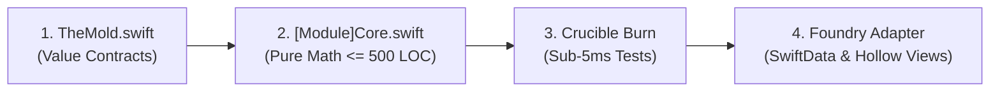

# Runalyst Core Development Guide: Adding & Extending Domain Modules

This guide establishes the mandatory workflow for designing, implementing, and verifying sports science logic within the **RunalystCore** Local Swift Package under the **Assay-Driven Engineering Model**.

---

## 1. The 27-Module Core Architecture

`RunalystCore` is a standalone, sans-I/O Swift Package containing 27 cohesive domain modules. It serves as the single source of truth for all biomechanical, physiological, and scheduling calculations.

### Strict Air-Gap Invariants
1. **Framework Isolation**: Imports only `Foundation`. Never import `HealthKit`, `SwiftData`, `CoreML`, `SwiftUI`, `OSLog`, or `FoundationModels`.
2. **Determinism**: Zero wall-clock calls (`Date()`, `Date.now`, `Calendar.current`). Time boundaries must be accepted explicitly as `TimeInterval` epoch seconds or `DateInterval` ranges.
3. **Mass Limit (< 500 LOC per File)**: Every `.swift` file in `RunalystCore/Sources` must stay under 500 lines of code.

### The Companion Extension Pattern (<Module>+Extension.swift)
When a core module approaches 450–500 LOC as domain capabilities expand:
- **Never Code-Golf**: Do not compress code, delete whitespace, combine lines artificially, or remove edge-case guards just to meet the 500 LOC cap.
- **Split into Companion Extensions**: Factor cohesive domain methods into a companion `<Module>+Extension.swift` file.
  - Examples in the core:
    - `DrillScheduleCore.swift` (schedule builder) + `DrillScheduleCore+Breakdown.swift` (step-phase time breakdown calculation).
    - `DrillPatternCore.swift` (archetype definitions) + `DrillPatternCore+Extended.swift` (progression cues & adaptations).
    - `PhysiologicalDiagnosisCore.swift` (overstride & drift formulas) + `PhysiologicalDiagnosisCore+Takeaways.swift` (deterministic coaching takeaways).

---

## 2. The Four-Step Core Development Pipeline



### Step 1: Prospecting & Updating "The Mold"
Before writing domain logic, define immutable data contracts in `RunalystCore/Sources/RunalystCore/TheMold.swift`.
- Value types must be `Sendable`, `Codable`, and `Equatable`.
- Accept pure primitives (`Double`, `Int`, `TimeInterval`, `DateInterval`) rather than framework objects.

### Step 2: Forging the Core Ingot
Create or extend the isolated module in `RunalystCore/Sources/RunalystCore/[FeatureName]Core.swift`.
- Implement pure functions over `TheMold` types.
- Ensure all calculations are deterministic and side-effect free.
- If approaching 500 LOC, create `[FeatureName]Core+[Subdomain].swift`.

### Step 3: Igniting the Crucible (Sub-5ms Unit Tests)
Write deterministic tests in `RunalystCore/Tests/RunalystCoreTests/[FeatureName]CoreTests.swift`.
- Leverage `GoldenTelemetryFixtures` for authentic sensor streams.
- Use `TelemetryNoiseInjector` to test resilience against sensor jitter (+/- 1.2 SPM, +/- 1.5 BPM, +/- 3.0 s/km).
- The test suite must execute in under 5 milliseconds on a CPU without launching a simulator.

### Step 4: Foundry Adapter & Hollow View Handshake
Connect the proven core math to the iOS app:
- **Foundry Adapter (`Runalyst/Engine/` or `Runalyst/Managers/`)**: Hydrate persistence records, map to `RunalystCore` types, and commit SwiftData updates via `@ModelActor`.
- **Hollow Presentation (`Runalyst/Views/` & `DrillReadout.swift`)**: Bind views strictly to the computed core structs. Never write domain thresholds (e.g. `percentZone4 > 0.15`) or phase math inside views.

---

## 3. Standard Template for a Core Module

```swift
import Foundation

/// Physiological or biomechanical calculation contract.
public enum [FeatureName]Core {

    public struct Parameters: Sendable, Codable, Equatable {
        public let threshold: Double

        public init(threshold: Double) {
            self.threshold = threshold
        }
    }

    public struct Result: Sendable, Codable, Equatable {
        public let computedMetric: Double
        public let isSatisfied: Bool

        public init(computedMetric: Double, isSatisfied: Bool) {
            self.computedMetric = computedMetric
            self.isSatisfied = isSatisfied
        }
    }

    /// Evaluates deterministic domain math over raw telemetry buckets.
    public static func evaluate(
        buckets: [TelemetryBucket],
        parameters: Parameters
    ) -> Result {
        guard !buckets.isEmpty else {
            return Result(computedMetric: 0.0, isSatisfied: false)
        }

        let metric = calculateMetric(from: buckets)
        let satisfied = metric >= parameters.threshold
        return Result(computedMetric: metric, isSatisfied: satisfied)
    }

    private static func calculateMetric(from buckets: [TelemetryBucket]) -> Double {
        let total = buckets.reduce(0.0) { $0 + $1.heartRateBPM }
        return buckets.isEmpty ? 0.0 : total / Double(buckets.count)
    }
}
```

---

## 4. Spec-Driven Development & Org Delegation

Every non-trivial core modification must follow the **OpenSpec** process:
1. Propose change via `/opsx-propose` (`proposal.md`, `specs/`, `design.md`, `tasks.md`).
2. Delegate tasks to the appropriate Engineering Org tier:
   - **`[Senior | pro]`**: Complex sports science math and `@ModelActor` concurrency.
   - **`[Mid/Jnr | flash]`**: Unit tests, hollow views, and adapter wiring.
   - **`[Scout | flash_lite]`**: Pre-implementation recon and post-implementation audits.
3. Validate with `/opsx-verify` before archiving with `/opsx-archive`.

---

## 5. Verification Gate: `./assay.sh`

Before committing or opening a pull request, run the root verification script:

```bash
./assay.sh
```

All 5 gates must pass:
1. Gate 1: Framework Directory Air-Gap
2. Gate 1b: Determinism Air-Gap (zero wall-clock time)
3. Gate 2: SwiftLint strict compliance
4. Gate 3: File mass ceiling (`<= 500 LOC`)
5. Gate 4: Grounded Voice Doctrine lexicon audit
6. Gate 5: Crucible test suite execution
